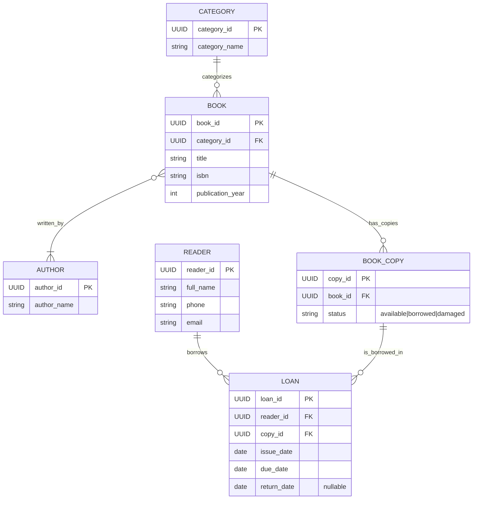

# Завдання 1
# 0. Чому цей домен?
* Наявнысть розмежування між самою книгою та копіями
* Наявність зв'язку M:N
* Наявність історії видачи з чітким фіксуванням дати

# 1. Що просили в AI
Усі промпти, відповіді та мої правки збережено в ai/prompt. Завданням було згенерувати Mermaid-діаграму за специфікацією без зайвих сполучних таблиць.
  
## 2. Ключове рішення (ADR)
Ключове архітектурне рішення про розділення абстрактної книги та її фізичного примірника задокументовано у форматі MADR:
[`adr/0001-separate-book-and-bookcopy.md`](adr/0001-separate-book-and-bookcopy.md).

# 3. Топ-3 виправлених розбіжностей (spec - модель)

Провів аудит моделі та відкоригував розбіжності через оновлення специфікації та окремі коміти:

## 3. Аудит топ-3 розбіжностей (spec.md ↔ ER-модель)

Усі розбіжності зафіксовано реальними комітами в історії репозиторію:

| № | Пункт у spec.md | Опис розбіжності | Як усунуто | SHA зміни spec.md | SHA зміни діаграми |
| :- | :--- | :--- | :--- | :--- | :--- |
| 1 | §2, п. 2 (Book ↔ Author) | У первинній діаграмі стояло BOOK }\|--\|{ AUTHOR (автор обов'язково має книгу). | Зафіксовано в spec.md та змінено кардинальність на BOOK }o--\|{ AUTHOR (автор може існувати без книг). | 4d74f7c | 89c9f55 |
| 2 | §1, п. 6 (return_date) | У первинній діаграмі AI поле return_date було обов'язковим. | Зафіксовано опціональність (null) у spec.md та додано позначку "nullable" на діаграмі. | 4d74f7c | 89c9f55 |
| 3 | §1, п. 5 (status) | На первинній діаграмі AI тип був вказаний як загальний string status. | Уточнено список переліку у spec.md та додано підказку "available\|borrowed\|damaged" на діаграмі. | 4d74f7c | 89c9f55 |

# 4. Обґрунтування 3NF

* Чому Category винесено в окрему сутність? Якщо зберігати назву категорії строкою в сутності Book, виникне дублювання даних для книг однієї категорії. Це створює аномалію оновлення. Винесення в Category забезпечує відсутність транзитивної залежності.
* Чому Loan із трьома датами не порушує 3NF? Дати issue_date, due_date та return_date описують безпосередньо факт конкретної видачі примірника читачу. Вони є атомарними й повністю залежать від первинного ключа loan_id, а не від читача чи книжки.
* Чому Book і Author без проміжної сутності? Зв'язок M:N є чисто концептуальним і не має власних атрибутів, тому моделюється напряму між сутностями.

## 5. Перевірка (Аудит узгодженості)

Перевірка специфікації та діаграми здійснювалася вручну за такими етапами:
* Перевірка атомарності: Зафіксовано, що full_name, phone та email зберігаються як окремі атрибути.
* Єдність ключів: Перевірено, що всі PK та FK мають єдиний тип UUID.
* Байт-в-байт узгодженість: Кожну назву сутності та атрибута зі spec.md звірено з виходом er-diagram.mmd.

# Завдання 2
## 1. Межі сценаріїв та обґрунтування
Для поглибленої деталізації обрано Use Case "Оформити видачу примірника читачу". Його межі охоплюють перевірку стану примірника, перевірку наявності боргів у читача та безпосередньо фіксацію видачі. Зовнішні процеси винесені в Out of Scope для збереження чистоти прецеденту.

## 2. Топ-3 виправлених розбіжностей (Вимоги ↔ ER-модель Завдання 1)

| № | Пункт у spec.md | Опис розбіжності | Як усунуто | SHA зміни spec.md |
| :- | :--- | :--- | :--- | :--- | :--- |
| 1 | §3 (Gherkin 1) | Початково AI пропонував змінювати статус сутності Book. | Виправлено: статус змінюється у BookCopy (status), що відповідає 3NF та розділенню з Завдання 1. | Виправлено на момент перевірки генерації перед комітом |
| 2 | §4 (FR-01 EARS) | AI пропонував заповнювати return_date під час створення видачі. | Виправлено: заповнюються лише issue_date та due_date, а return_date залишається null. | Виправлено на момент перевірки генерації перед комітом |
| 3 | §1 (Актори) | AI додав зовнішній актор "Email Service" на Use Case діаграму. | Вилучено Email Service з акторів, оскільки сервіс не ініціює взаємодію самостійно. | Виправлено на момент перевірки генерації перед комітом |

## 3. Обґрунтування NFR
Усі NFR виражені кількісно:
* Час відгуку =<200 мс та навантаження 50 запитів/хв забезпечують комфортну роботу бібліотекаря без затримок у черзі.
* Вимоги безпеки гарантують захист персональних даних читачів.

## 4. Перевірка трасування
Усі сформульовані EARS-вимоги (FR-01...FR-04) на 100% покриті Gherkin-сценаріями та прив'язані до відповідних Use Cases у матриці трасування.
