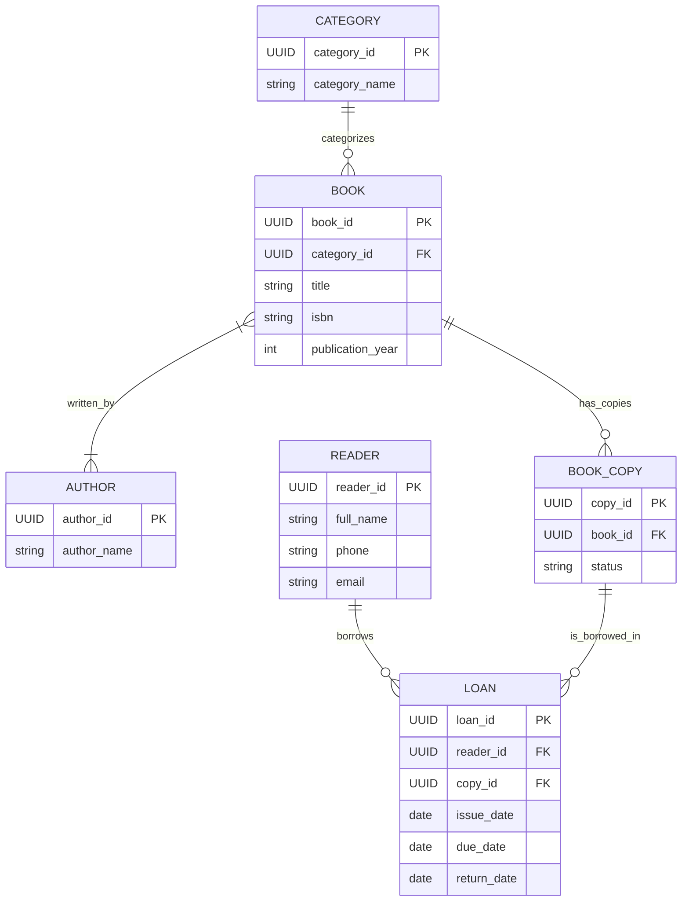

## 1. ER DIAGRAM
> "Згенеруй концептуальну ER-модель для системи управління бібліотекою на основі специфікації spec.md у синтаксисі Mermaid erDiagram. Не використовуй проміжні таблиці для N:M."

Reader:
reader_id (PK, UUID)
full_name (string)
phone (string)
email (string)

Book:
book_id (PK, UUID)
title (string)
isbn (string)
publication_year (int)
category_id (FK, UUID)

Category:
category_id (PK, UUID)
category_name (string)

Author:
author_id (PK, UUID)
author_name (string)

BookCopy:
copy_id (PK, UUID)
book_id (FK, UUID)
status (string)

Loan:
loan_id (PK, UUID)
reader_id (FK, UUID)
copy_id (FK, UUID)
issue_date (date)
due_date (date)
return_date (date, optional)

Category 1:N Book
Book N:M Author
Book 1:N BookCopy
Reader 1:N Loan
BookCopy 1:N Loan

## Що відхилено або виправлено:
  1. Початково AI запропонував поле publish_year замість publication_year. Відхилено, повернуто publication_year згідно зі spec.
  2. Початково AI згенерував відсутність відображення обов'язковості для return_date. Уточнено бізнес-логіку: return_date є optional (null).
  3. Перевірено сутність Loan - залишено як асоціативну сутність, оскільки вона має власні часові атрибути.

## 2. Сира відповідь AI

# Уточнювальні Питання від AI:
* Питання AI: Чи потрібно створювати таблицю Book_Author для M:N?
* Відповідь: Ні, зв'язок між Book та Author моделюється як чистий M:N без сполучної таблиці.

# Аналіз відповіді:
Прийнято: Загальна структура сутностей, чистий зв'язок M:N без Book_Author, використання UUID для всіх ключів.

## Виявлені та виправлені розбіжності:

* AI згенерував строгий зв'язок BOOK }|--|{ AUTHOR (1..N). За spec.md автор може існувати без книг (0..N). Виправлено у spec.md (4d74f7c) та діаграмі (89c9f55) на BOOK }o--|{ AUTHOR.
* Атрибут return_date у виході AI був обов'язковим. У spec.md зафіксовано null значення. У діаграмі додано маркер "nullable" (89c9f55).
* Статус примірника status у первинній відповіді AI був просто строкою. Додано уточнення можливих значень "available|borrowed|damaged" у діаграмі (89c9f55).
